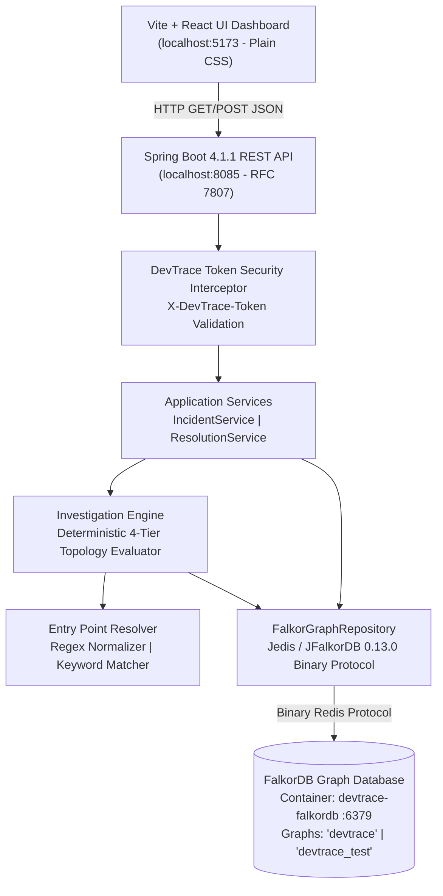
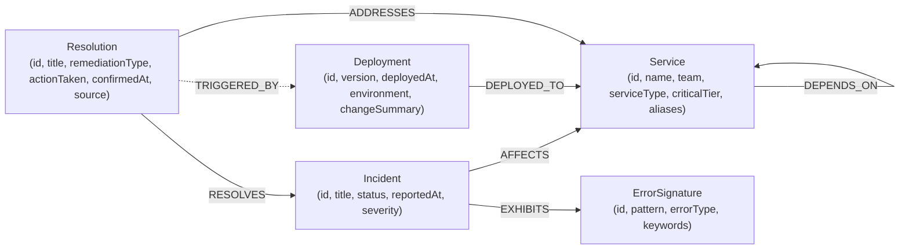

# DevTrace AI — Graph-Native Incident Investigation & Remediation Knowledge Graph

> **Hackathon Submission**: WeMakeDevs × FalkorDB "Graph Hacks" Hackathon (Oct 2026)  
> **Track**: **Track 01 — Agents That Act on Connected Data**  
> **Public Repository**: [https://github.com/manohar-kunda/DevTraceAI](https://github.com/manohar-kunda/DevTraceAI)  
> **Deployment Model**: Complete, reproducible local development and evaluation environment.

---

## 1. Problem & Solution

### The Operational Challenge
In microservice architectures, when a downstream component degrades (e.g., database connection pool exhaustion), failure symptoms cascade upward across dependency tiers. SRE on-call engineers receive alerts on upstream client-facing services (e.g. `checkout-service`), while the actual root cause resides multiple network hops away (e.g. `payment-service` misconfiguration).

Traditional observability tools isolate metrics and logs into disconnected silos. SREs are forced to manually correlate deployment events, topological call graphs, and past post-mortems across fragmented dashboards. Furthermore, when an incident is resolved, remediation knowledge is archived in static wikis or Slack threads, disconnected from the operational graph and inaccessible to future automated investigations.

### The DevTrace AI Solution
**DevTrace AI** is an operational incident investigation engine powered by **FalkorDB** that acts directly on connected topology, deployment events, and historical resolutions.

- **Deterministic Root-Cause Ranking**: Combines topological reachability, directional call graphs, deployment recency within a temporal window, and structured historical resolution matching into transparent ranking tiers (`STRONG`, `MODERATE`, `WEAK`).
- **Explainable Failure Propagation**: Automatically computes directed dependency paths from the symptom service to candidates, reverse failure propagation, and upstream blast radius callers.
- **Closed-Loop Knowledge Graph Evolution**: Human SRE mitigation actions are confirmed via authenticated write-back, creating verified `Resolution` nodes in FalkorDB that immediately inform future incident triage.

---

## 2. Why a Graph? (Graph-Native Advantage)

Relational databases or isolated document stores require expensive recursive joins or complex application-layer graph walks to compute topological reachability, cycle detection, and variable-length dependency paths. 

In FalkorDB:
1. **Topology as First-Class State**: Traversals across `[:DEPENDS_ON*1..3]` are executed in sub-millisecond query times via sparse matrix graph algorithms.
2. **Deterministic Graph Removal Behavior**: If topology or entities are missing, the system does not hallucinate. When evaluated against an empty graph or an isolated component, DevTrace AI deterministically returns `INSUFFICIENT_EVIDENCE` with explicit missing evidence diagnostics.
3. **Dynamic Knowledge Linking**: Past resolutions are joined directly to services via `[:ADDRESSES]` and incidents via `[:RESOLVES]`. A single query joins symptoms, candidate services, recent changes, and historical provenances.

---

## 3. System Architecture



---

## 4. Graph Data Model

The graph schema models services, deployment events, error signatures, incidents, and remediations.



### Graph Entity Specifications

| Label | Key Properties | Purpose |
|---|---|---|
| `:Service` | `id`, `name`, `team`, `serviceType`, `criticalTier`, `aliases` | Microservice or backing data store in the service mesh. |
| `:Deployment` | `id`, `version`, `deployedAt`, `environment`, `deployedBy`, `changeSummary` | Change event associated with a specific service. |
| `:ErrorSignature`| `id`, `pattern`, `errorType`, `keywords` | Known technical failure pattern (e.g. ConnectionTimeout). |
| `:Incident` | `id`, `title`, `status`, `reportedAt`, `severity` | SRE operational incident (`OPEN` or `RESOLVED`). |
| `:Resolution` | `id`, `title`, `remediationType`, `actionTaken`, `confirmedAt`, `confirmedBy`, `source` | Confirmed remediation (`synthetic` or `user-confirmed`). |

For full schema constraints and index definitions, see [docs/GRAPH_MODEL.md](file:///C:/Users/manoh/DevTraceAI/docs/GRAPH_MODEL.md).

---

## 5. Key Cypher Queries

DevTrace AI executes parameterized Cypher queries over the binary Redis protocol:

### 1. Directed Dependency Traversal (Downstream Search)
```cypher
MATCH path = (source:Service {id: $serviceId})-[:DEPENDS_ON*1..3]->(callee:Service)
WITH callee, min(length(path)) AS minHops
ORDER BY minHops ASC, callee.id ASC
RETURN callee.id AS id, callee.name AS name, callee.serviceType AS serviceType, minHops AS hops
```

### 2. Upstream Blast Radius Analysis
```cypher
MATCH path = (caller:Service)-[:DEPENDS_ON*1..3]->(target:Service {id: $serviceId})
WITH caller, min(length(path)) AS minHops
ORDER BY minHops ASC, caller.id ASC
RETURN caller.id AS id, caller.name AS name, caller.serviceType AS serviceType, minHops AS hops
```

### 3. Historical Incident Matching with Provenance
```cypher
MATCH (i:Incident {status: 'RESOLVED'})-[:EXHIBITS]->(e:ErrorSignature {id: $sigId})
MATCH (i)-[:AFFECTS]->(aff:Service)
MATCH (r:Resolution)-[:RESOLVES]->(i)
MATCH (r)-[:ADDRESSES]->(s:Service)
WHERE (s.id IN $serviceIds OR aff.id IN $serviceIds)
  AND ($excludeIncidentId = '' OR i.id <> $excludeIncidentId)
RETURN i.id AS incidentId, i.title AS title, i.status AS status,
       collect(DISTINCT aff.id) AS affectedServiceIds, s.id AS addressedServiceId,
       r.id AS resId, r.title AS resTitle, r.remediationType AS resRemediationType,
       r.actionTaken AS resActionTaken, r.confirmedAt AS resConfirmedAt,
       r.confirmedBy AS resConfirmedBy, r.source AS resSource
ORDER BY r.confirmedAt DESC, i.id ASC
```

### 4. Atomic Resolution Write-Back (Knowledge Evolution)
```cypher
MATCH (i:Incident {id: $incidentId})
MATCH (s:Service {id: $serviceId})
MATCH (d:Deployment {id: $deploymentId})
SET i.status = 'RESOLVED'
MERGE (r:Resolution {id: $resId})
ON CREATE SET r.title = $title, r.remediationType = $remediationType,
              r.actionTaken = $actionTaken, r.confirmedAt = $confirmedAt,
              r.confirmedBy = $confirmedBy, r.source = 'user-confirmed'
MERGE (r)-[r1:RESOLVES]->(i) ON CREATE SET r1.source = 'user-confirmed'
MERGE (r)-[r2:ADDRESSES]->(s) ON CREATE SET r2.source = 'user-confirmed'
MERGE (r)-[r3:TRIGGERED_BY]->(d) ON CREATE SET r3.source = 'user-confirmed'
RETURN r.id AS id, r.source AS source
```

For complete query documentation, see [docs/QUERIES.md](file:///C:/Users/manoh/DevTraceAI/docs/QUERIES.md).

---

## 6. How Ranking Tiers & Write-Back Learning Work

### Deterministic Ranking Rules
Rather than opaque floating-point scores, DevTrace AI evaluates candidates strictly against 4 transparent operational tiers:

- **`STRONG` Tier**: Candidate service is within the dependency neighborhood, has a deployment within the temporal window, AND matches an `ErrorSignature` historically resolved on that service.
- **`MODERATE` Tier**: Candidate service is within the dependency neighborhood and has a deployment within the window, but lacks matching historical incident signatures.
- **`WEAK` Tier**: Candidate service is in the dependency neighborhood but has no recent deployment (reported under `otherServicesInNeighborhood`).
- **Ignored**: Changes on services outside the directed dependency path (e.g. `notification-service`) are explicitly excluded and recorded under `ignoredChanges`.

For full ranking specifications and tie-break rules, see [docs/RANKING.md](file:///C:/Users/manoh/DevTraceAI/docs/RANKING.md).

### Closed-Loop Write-Back Learning
Engine diagnostics are strictly read-only. Knowledge graph evolution occurs only when an authenticated human SRE confirms a remediation:
1. Validates authentication token via constant-time comparison.
2. Changes incident status to `RESOLVED`.
3. Creates a `Resolution` node marked with `source: 'user-confirmed'` and the server's UTC timestamp.
4. On future incidents exhibiting the same error signature, this remediation is automatically surfaced as top-ranked historical evidence.

---

## 7. Setup & Execution Guide

### Prerequisites
- **Java**: JDK 25 LTS (verified with OpenJDK 25.0.4.1)
- **Maven**: 3.9+ (verified with Apache Maven 3.9.16)
- **Docker**: Docker Desktop with Compose v2
- **Node.js**: v20+ or v24+ with npm (verified with Node v24.21.0, npm 11.19.0)

### 1. Environment Configuration
Copy `.env.example` to `.env` and set your credentials:
```bash
# On Linux / macOS:
cp .env.example .env

# On Windows (cmd / PowerShell):
copy .env.example .env
```
Edit `.env` and configure:
```env
FALKORDB_HOST=127.0.0.1
FALKORDB_PORT=6379
FALKORDB_PASSWORD=your_secure_password_here
FALKORDB_GRAPH=devtrace
DEVTRACE_API_TOKEN=your_secure_api_token_here
```

### 2. Start FalkorDB
```bash
docker compose up -d
```
Verify the container is healthy:
```bash
docker compose ps
```

### 3. Reset or Seed the Database
To reset the development graph `devtrace` to the clean golden state before running a demo:
```bash
# Set flags in environment and launch seed bootstrap:
# Windows PowerShell:
$env:DEVTRACE_SEED_ENABLED="true"; $env:DEVTRACE_SEED_RESET="true"; mvn spring-boot:run

# Linux / macOS:
DEVTRACE_SEED_ENABLED=true DEVTRACE_SEED_RESET=true mvn spring-boot:run
```
*(Stop with Ctrl+C after seeding completes, or leave running as backend).*

### 4. Run the Test Suites
- **Offline Unit Tests** (requires NO Docker or FalkorDB running):
  ```bash
  mvn test
  ```
  Runs 40 isolated unit tests in under 4 seconds.
- **Integration Test Suite** (requires Docker container running):
  ```bash
  mvn verify
  ```
  Runs all 40 unit tests plus 30 FalkorDB integration tests against graph `devtrace_test`.

### 5. Start Backend & Frontend
**Backend (Port 8085)**:
```bash
mvn spring-boot:run
```
Health check:
```bash
curl.exe http://localhost:8085/api/health
```

**Frontend (Port 5173)**:
```bash
cd frontend
npm install
npm run dev
```
Open [http://localhost:5173](http://localhost:5173) in your browser.

---

## 8. Demo Walkthrough of the Golden Scenario

1. Open [http://localhost:5173](http://localhost:5173). Notice the **`● Synthetic Demo Data`** pill.
2. Click **"Load Demo Golden Incident"**:
   - Pre-fills incident description: `"Checkout requests are failing after the latest deployment and payment timeouts have increased"`.
   - Leaves service and error hints blank, demonstrating the **free-text keyword resolver**.
3. Click **"Investigate Incident"**:
   - **Resolved Entry Points**: Resolves symptom service `checkout-service` and error signature `err-sig-payment-pool-timeout`.
   - **Observed Facts**: Displays recent deployments on `inventory-service` (10m before) and `payment-service` (30m before), plus historical incident `inc-2026-08-12-pay`.
   - **Ranked Hypotheses**:
     - `#1 payment-service` (**STRONG TIER**): Has recent deployment `v2.4.1` and historical incident with confirmed remediation `res-pay-timeout-fix`.
     - `#2 inventory-service` (**MODERATE TIER**): Has recent deployment `v1.5.0`, but zero error signature matches.
   - **Topological Paths**: Displays `service-checkout ──[:DEPENDS_ON]──► service-order ──[:DEPENDS_ON]──► service-payment` (2 hops).
   - **Ignored Changes**: `dep-notification-v1.8.0` is ignored because `notification-service` is outside the dependency neighborhood.
4. **Human-in-the-Loop Confirmation**:
   - Enter remediation details and enter your `DEVTRACE_API_TOKEN`.
   - Click **"Confirm Resolution & Evolve Graph"**.
   - Verified: Green confirmation banner appears with new resolution ID `res-inc-2026-10-15-checkout-001` marked `source: user-confirmed`.

For exact step-by-step recording instructions, see [docs/DEMO_SCRIPT.md](file:///C:/Users/manoh/DevTraceAI/docs/DEMO_SCRIPT.md).

---

## 9. AI-Assisted Development Disclosure

In accordance with hackathon guidelines, the development of DevTrace AI utilized AI pair programming assistance:

- **AI Tools & Models Used**:
  - Tool / Assistant: `[INSERT TOOLS USED: e.g. Google Antigravity / Gemini 2.5 Pro / Claude 3.7 Sonnet]`
  - Models: `[INSERT SPECIFIC MODEL IDENTIFIERS]`
- **Human Engineering & Architecture**:
  - Designed the FalkorDB graph schema, bidirectional relationship semantics, and constraint models.
  - Formulated the 4-tier ranking rules and deterministic tie-breaking logic.
  - Specified the fail-closed security boundary, RFC 7807 problem details error mapping, and atomic Cypher write-back transactions.
  - Authored and verified all test assertions across the 40 Surefire and 30 Failsafe test suites.
- **AI-Assisted Contributions**:
  - Scaffolding repetitive boilerplate (DTO records, MockMvc controller test setups, CSS utility layout).
  - Drafting initial Cypher syntax patterns and Spring Boot configuration bindings.

---

## 10. Synthetic Data Notice & Limitations

- **Synthetic Data**: All microservices, team names, alert summaries, git versions, deployments, and incident timestamps in this repository are **100% synthetic**. No real company, production telemetry, or customer data is used.
- **Deterministic Heuristic**: DevTrace AI uses deterministic topological analysis and recency rules. It does not output uncalibrated probabilistic machine-learning guesses.
- **Human Verification Required**: Destructive remediations (rollbacks, restarts, config patches) require human SRE authorization before execution.
- **MCP Integration Status**: Model Context Protocol (MCP) server integration is architected and documented as future work. The current product operates deterministically via REST and direct FalkorDB graph traversal.
