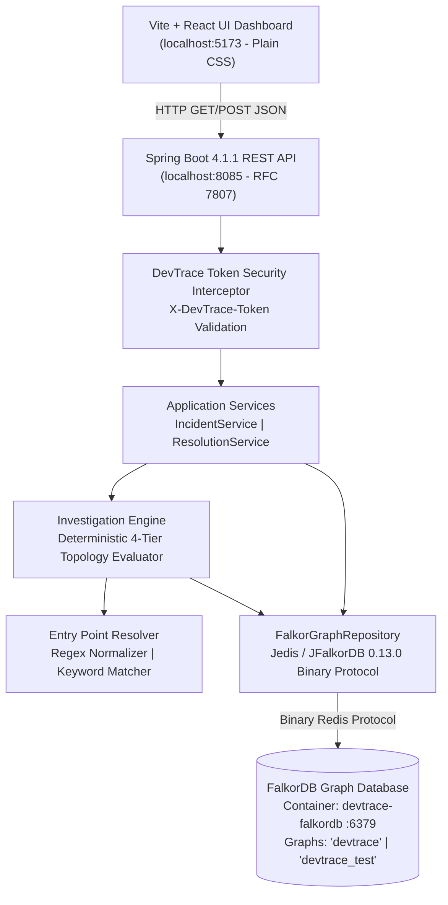
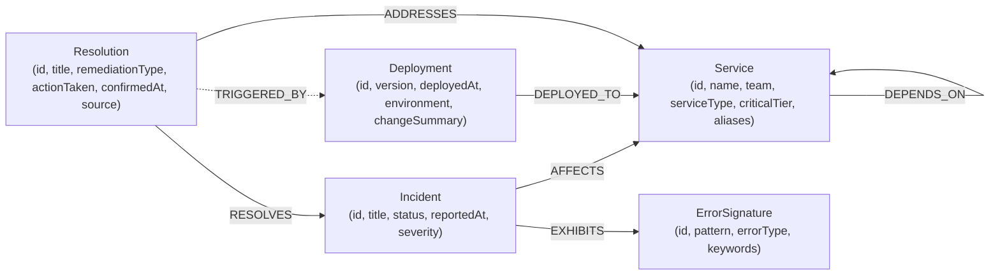

# DevTrace AI — Graph-Native Incident Investigation & Remediation Knowledge Graph

> **Hackathon Submission**: WeMakeDevs × FalkorDB "Graph Hacks" Hackathon (Oct 2026)  
> **Track**: **Track 01 — Agents That Act on Connected Data**  
> **Public Repository**: [https://github.com/manohar-kunda/DevTraceAI](https://github.com/manohar-kunda/DevTraceAI)  
> **Deployment Model**: Complete, reproducible local development and evaluation environment.

---

## 1. Problem & Solution

### The Operational Challenge
In microservice architectures, when a downstream component degrades (e.g., database connection pool exhaustion), failure symptoms cascade upward across dependency tiers. SRE on-call engineers receive alerts on upstream client-facing services (e.g. `checkout-service`), while the actual root cause resides multiple network hops away (e.g. `payment-service` misconfiguration).

Traditional observability tools isolate metrics and logs into disconnected silos. SREs are forced to manually correlate deployment events, topological call graphs, and past post-mortems across fragmented dashboards. Furthermore, when an incident is resolved, remediation knowledge is archived in static wikis or Slack threads, disconnected from the operational graph and inaccessible to future automated investigations.

### The DevTrace AI Solution
**DevTrace AI** is an operational incident investigation engine powered by **FalkorDB** that acts directly on connected topology, deployment events, and historical resolutions.

- **Deterministic Root-Cause Ranking**: Combines topological reachability, directional call graphs, deployment recency within a temporal window, and structured historical resolution matching into transparent ranking tiers (`STRONG`, `MODERATE`, `WEAK`).
- **Explainable Failure Propagation**: Automatically computes directed dependency paths from the symptom service to candidates, reverse failure propagation, and upstream blast radius callers.
- **Closed-Loop Knowledge Graph Evolution**: Human SRE mitigation actions are confirmed via authenticated write-back, creating verified `Resolution` nodes in FalkorDB that immediately inform future incident triage.

---

## 2. Why a Graph? (Graph-Native Advantage)

Relational databases or isolated document stores require expensive recursive joins or complex application-layer graph walks to compute topological reachability, cycle detection, and variable-length dependency paths. 

In FalkorDB:
1. **Topology as First-Class State**: Traversals across `[:DEPENDS_ON*1..3]` are executed in sub-millisecond query times via sparse matrix graph algorithms.
2. **Deterministic Graph Removal Behavior**: If topology or entities are missing, the system does not hallucinate. When evaluated against an empty graph or an isolated component, DevTrace AI deterministically returns `INSUFFICIENT_EVIDENCE` with explicit missing evidence diagnostics.
3. **Dynamic Knowledge Linking**: Past resolutions are joined directly to services via `[:ADDRESSES]` and incidents via `[:RESOLVES]`. A single query joins symptoms, candidate services, recent changes, and historical provenances.

---

## 3. System Architecture



### Frontend Architecture (Single Page Application)

The frontend is a modular React 19 single-page application built with Vite and plain CSS (zero external UI kits or third-party routers):

```
frontend/src/
├── api/
│   ├── client.js              # Sanitized fetch wrapper with RFC 7807 problem details
│   └── endpoints.js           # Investigation, demo, resolution, and health API bindings
├── components/
│   ├── common/
│   │   ├── Badge.jsx          # Tier (STRONG/MODERATE) & provenance (user/synthetic) badges
│   │   ├── DemoGuide.jsx      # 4-step guided walk-through progress panel
│   │   ├── ErrorBanner.jsx    # Accessible RFC 7807 alert with role="alert"
│   │   ├── FieldHelp.jsx      # Form input help text
│   │   ├── Glossary.jsx       # Collapsible plain-English term glossary
│   │   └── Section.jsx        # Semantic cards & details/summary accordion wrappers
│   ├── incident/
│   │   ├── AdvancedOptions.jsx # Collapsible service/error hints, ID, and epoch preview
│   │   ├── DemoButtons.jsx    # Clearly labeled DEMO scenario loaders
│   │   └── IncidentForm.jsx   # Free-text symptom input form
│   ├── report/
│   │   ├── BlastRadius.jsx    # Upstream affected caller tags
│   │   ├── DependencyChain.jsx # Visual box-and-arrow call path
│   │   ├── EntryPoints.jsx    # Section A resolved service & error signature
│   │   ├── EvidenceList.jsx   # Deployments in temporal analysis window
│   │   ├── HistoryList.jsx    # Section B matched historical incidents & provenances
│   │   ├── HypothesisCard.jsx # Plain-language root cause explanation
│   │   ├── IgnoredChanges.jsx # Deployments outside dependency neighborhood
│   │   ├── Limitations.jsx    # Reasoning boundaries and assumptions
│   │   ├── NextSteps.jsx      # Suggested operational triage actions
│   │   └── ReportSummary.jsx  # Hero summary card with lead suspect & tier
│   └── resolution/
│       ├── ConfirmationBanner.jsx # Graph evolution feedback & demo B trigger
│       ├── ResolutionForm.jsx # Human confirmation form with candidate select
│       └── TokenField.jsx     # In-memory masked token input with 5-step help
├── demo/
│   └── demoData.js            # Synthetic demo fixtures (Incident B, Demo Resolution)
├── hooks/
│   ├── useHashRoute.js        # 20-line hash router for back/forward navigation
│   └── useInvestigation.js    # State machine: idle, loading, success, error
├── pages/
│   ├── DescribePage.jsx       # Step 1: Incident description and demo loader
│   ├── ResultPage.jsx         # Step 2: Investigation findings & accordion details
│   └── ConfirmPage.jsx        # Step 3: Human confirmation & knowledge write-back
├── styles/
│   ├── components.css         # Responsive styles, stepper, accessible focus, reduced motion
│   └── variables.css          # Design tokens (colors, WCAG AA contrast, radii, spacing)
├── utils/
│   └── format.js              # UTC formatting, relative time, pluralization, candidate extraction
├── App.jsx                    # Layout, header with health pill, and stepper navigation (145 lines)
└── main.jsx                   # React entry point
```

---

## 4. Graph Data Model

The graph schema models services, deployment events, error signatures, incidents, and remediations.



### Graph Entity Specifications

| Label | Key Properties | Purpose |
|---|---|---|
| `:Service` | `id`, `name`, `team`, `serviceType`, `criticalTier`, `aliases` | Microservice or backing data store in the service mesh. |
| `:Deployment` | `id`, `version`, `deployedAt`, `environment`, `deployedBy`, `changeSummary` | Change event associated with a specific service. |
| `:ErrorSignature`| `id`, `pattern`, `errorType`, `keywords` | Known technical failure pattern (e.g. ConnectionTimeout). |
| `:Incident` | `id`, `title`, `status`, `reportedAt`, `severity` | SRE operational incident (`OPEN` or `RESOLVED`). |
| `:Resolution` | `id`, `title`, `remediationType`, `actionTaken`, `confirmedAt`, `confirmedBy`, `source` | Confirmed remediation (`synthetic` or `user-confirmed`). |

For full schema constraints and index definitions, see [docs/GRAPH_MODEL.md](file:///C:/Users/manoh/DevTraceAI/docs/GRAPH_MODEL.md).

---

## 5. Key Cypher Queries

DevTrace AI executes parameterized Cypher queries over the binary Redis protocol:

### 1. Directed Dependency Traversal (Downstream Search)
```cypher
MATCH path = (source:Service {id: $serviceId})-[:DEPENDS_ON*1..3]->(callee:Service)
WITH callee, min(length(path)) AS minHops
ORDER BY minHops ASC, callee.id ASC
RETURN callee.id AS id, callee.name AS name, callee.serviceType AS serviceType, minHops AS hops
```

### 2. Upstream Blast Radius Analysis
```cypher
MATCH path = (caller:Service)-[:DEPENDS_ON*1..3]->(target:Service {id: $serviceId})
WITH caller, min(length(path)) AS minHops
ORDER BY minHops ASC, caller.id ASC
RETURN caller.id AS id, caller.name AS name, caller.serviceType AS serviceType, minHops AS hops
```

### 3. Historical Incident Matching with Provenance
```cypher
MATCH (i:Incident {status: 'RESOLVED'})-[:EXHIBITS]->(e:ErrorSignature {id: $sigId})
MATCH (i)-[:AFFECTS]->(aff:Service)
MATCH (r:Resolution)-[:RESOLVES]->(i)
MATCH (r)-[:ADDRESSES]->(s:Service)
WHERE (s.id IN $serviceIds OR aff.id IN $serviceIds)
  AND ($excludeIncidentId = '' OR i.id <> $excludeIncidentId)
RETURN i.id AS incidentId, i.title AS title, i.status AS status,
       collect(DISTINCT aff.id) AS affectedServiceIds, s.id AS addressedServiceId,
       r.id AS resId, r.title AS resTitle, r.remediationType AS resRemediationType,
       r.actionTaken AS resActionTaken, r.confirmedAt AS resConfirmedAt,
       r.confirmedBy AS resConfirmedBy, r.source AS resSource
ORDER BY r.confirmedAt DESC, i.id ASC
```

### 4. Atomic Resolution Write-Back (Knowledge Evolution)
```cypher
MATCH (i:Incident {id: $incidentId})
MATCH (s:Service {id: $serviceId})
MATCH (d:Deployment {id: $deploymentId})
SET i.status = 'RESOLVED'
MERGE (r:Resolution {id: $resId})
ON CREATE SET r.title = $title, r.remediationType = $remediationType,
              r.actionTaken = $actionTaken, r.confirmedAt = $confirmedAt,
              r.confirmedBy = $confirmedBy, r.source = 'user-confirmed'
MERGE (r)-[r1:RESOLVES]->(i) ON CREATE SET r1.source = 'user-confirmed'
MERGE (r)-[r2:ADDRESSES]->(s) ON CREATE SET r2.source = 'user-confirmed'
MERGE (r)-[r3:TRIGGERED_BY]->(d) ON CREATE SET r3.source = 'user-confirmed'
RETURN r.id AS id, r.source AS source
```

For complete query documentation, see [docs/QUERIES.md](file:///C:/Users/manoh/DevTraceAI/docs/QUERIES.md).

---

## 6. How Ranking Tiers & Write-Back Learning Work

### Deterministic Ranking Rules
Rather than opaque floating-point scores, DevTrace AI evaluates candidates strictly against 4 transparent operational tiers:

- **`STRONG` Tier**: Candidate service is within the dependency neighborhood, has a deployment within the temporal window, AND matches an `ErrorSignature` historically resolved on that service.
- **`MODERATE` Tier**: Candidate service is within the dependency neighborhood and has a deployment within the window, but lacks matching historical incident signatures.
- **`WEAK` Tier**: Candidate service is in the dependency neighborhood but has no recent deployment (reported under `otherServicesInNeighborhood`).
- **Ignored**: Changes on services outside the directed dependency path (e.g. `notification-service`) are explicitly excluded and recorded under `ignoredChanges`.

For full ranking specifications and tie-break rules, see [docs/RANKING.md](file:///C:/Users/manoh/DevTraceAI/docs/RANKING.md).

### Closed-Loop Write-Back Learning
Engine diagnostics are strictly read-only. Knowledge graph evolution occurs only when an authenticated human SRE confirms a remediation:
1. Validates authentication token via constant-time comparison.
2. Changes incident status to `RESOLVED`.
3. Creates a `Resolution` node marked with `source: 'user-confirmed'` and the server's UTC timestamp.
4. On future incidents exhibiting the same error signature, this remediation is automatically surfaced as top-ranked historical evidence.

---

## 7. Setup & Execution Guide

### Prerequisites
Tested with: Java 25.0.4.1, Node 24.x, Maven 3.9.x, Docker Desktop.
- **Java**: Java 25 LTS (tested with OpenJDK `25.0.4.1`)
- **Maven**: Maven 3.9.x (tested with Apache Maven `3.9.16`)
- **Docker**: Docker Desktop with Compose v2
- **Node.js**: Node 24.x (tested with Node `v24.21.0`, npm `11.19.0`). `npm test` needs Node 22 or newer (the test script uses a glob pattern).

### 1. Environment Configuration
Copy `.env.example` to `.env` and set your credentials:
```bash
# On Linux / macOS:
cp .env.example .env

# On Windows (cmd / PowerShell):
copy .env.example .env
```
Edit `.env` and configure with your own generated secrets:
> [!IMPORTANT]
> Generate your own random `DEVTRACE_API_TOKEN` and `FALKORDB_PASSWORD` (e.g., using `openssl rand -hex 24` or PowerShell `-join ((48..57)+(65..90)+(97..122) | Get-Random -Count 32 | % {[char]$_})`). Never reuse example strings, and never commit `.env` to version control.

```env
FALKORDB_HOST=127.0.0.1
FALKORDB_PORT=6379
FALKORDB_PASSWORD=your_secure_random_password_here
FALKORDB_GRAPH=devtrace
DEVTRACE_API_TOKEN=your_secure_random_api_token_here
```

### What is the DevTrace API token?

- **What it protects**: It protects **only the resolution confirmation write endpoint** (`POST /api/incidents/{id}/resolution`). All read operations (health checks, graph queries, incident inspection) and the core investigation engine (`POST /api/investigate`) are public and do not require authentication.
- **Who creates it**: The token is **created by you (the user)**. It is not an external API key, account password, or third-party service credential.
- **How to generate one**: Generate any long, high-entropy random string:
  - Linux / macOS / Git Bash: `openssl rand -hex 32`
  - Windows PowerShell: `-join ((48..57)+(65..90)+(97..122) | Get-Random -Count 32 | % {[char]$_})`
- **Where it goes**: In the `.env` file located in the project root:
  ```env
  DEVTRACE_API_TOKEN=<your-token-from-.env>
  ```
- **How it is sent**:
  - **REST API / curl**: Via the `X-DevTrace-Token` HTTP header (e.g., `-H "X-DevTrace-Token: <your-token-from-.env>"`).
  - **Web Dashboard**: Entered into the masked **DevTrace API Token** input field in the resolution form before clicking "Confirm Resolution & Evolve Graph". The browser does not store or persist this token.
- **Backend restart requirement**: The Spring Boot backend reads `.env` on startup via `EnvLoader`. If you create or modify `.env`, you **must restart the backend** for changes to take effect.
- **Terminal environment variable precedence**: In `EnvLoader.java`, if `DEVTRACE_API_TOKEN` is already exported or set in your terminal shell environment (`System.getenv()` or `System.getProperty()`), **the terminal environment variable takes precedence over `.env`**. If you set or changed the token in `.env` but your shell has an existing `$env:DEVTRACE_API_TOKEN` / `export DEVTRACE_API_TOKEN`, the server will continue using the shell's value until unset or updated in the shell.
- **Never commit `.env`**: `.env` is listed in `.gitignore` and must never be tracked or committed to version control.
- **How to rotate it**: Edit `DEVTRACE_API_TOKEN` in `.env` (or change your shell environment variable) and restart the Spring Boot backend (`mvn spring-boot:run`).
- **Fail-closed behavior**: If `DEVTRACE_API_TOKEN` is left unset or empty, the backend fails closed: the resolution confirmation endpoint is automatically disabled and all confirmation attempts return `401 Unauthorized` with:
  `"The resolution confirmation endpoint is disabled because DEVTRACE_API_TOKEN is not configured on the server."`

### 2. Start FalkorDB
```bash
docker compose up -d
```
Verify the container is healthy:
```bash
docker compose ps
```

### 3. Reset or Seed the Database
To reset the development graph `devtrace` to the clean golden state before running a demo:
```bash
# Windows PowerShell (set for one run and unset immediately afterwards):
$env:DEVTRACE_SEED_ENABLED="true"; $env:DEVTRACE_SEED_RESET="true"; mvn spring-boot:run
# After seed completes, press Ctrl+C and unset the variables:
Remove-Item Env:DEVTRACE_SEED_RESET
Remove-Item Env:DEVTRACE_SEED_ENABLED

# Linux / macOS (scoped to single process invocation):
DEVTRACE_SEED_ENABLED=true DEVTRACE_SEED_RESET=true mvn spring-boot:run
```

> [!WARNING]
> Always unset `DEVTRACE_SEED_RESET` and `DEVTRACE_SEED_ENABLED` after seeding. Leaving them set in your shell environment will cause the graph to be reset on every subsequent backend startup, wiping any user-confirmed resolutions.

### 4. Run the Test Suites
- **Offline Unit Tests** (requires NO Docker or FalkorDB running):
  ```bash
  mvn test
  ```
  Runs 40 isolated unit tests in under 4 seconds.
- **Integration Test Suite** (requires Docker container running):
  ```bash
  mvn verify
  ```
  Runs all 40 unit tests plus 35 FalkorDB integration tests against graph `devtrace_test`.

### 5. Start Backend & Frontend
**Backend (Port 8085)**:
```bash
mvn spring-boot:run
```
Health check:
```bash
curl.exe http://localhost:8085/api/health
```

**Frontend (Port 5173)**:
```bash
cd frontend
npm install
npm run dev
```
Open [http://localhost:5173](http://localhost:5173) in your browser.

---

## 8. Performance & Concurrency Sanity Check

To evaluate engine responsiveness and thread safety under concurrent load on a standard development laptop, the test suite executes automated multi-threaded stress tests against a dedicated `devtrace_test` FalkorDB graph (`IncidentControllerIT`):

- **50 Parallel Incident Investigations**:
  - **Workload**: 50 concurrent threads executing end-to-end investigation requests against the Spring Boot REST API and FalkorDB graph traversals simultaneously.
  - **Determinism**: 100% of requests (50/50) returned HTTP 200 with identical root-cause hypothesis rankings (`payment-service` STRONG rank 1, `inventory-service` MODERATE rank 2).
  - **Measured Latency (Laptop Sanity Check)**:
    - **p50 (Median)**: **136 ms**
    - **p95 (95th Percentile)**: **297 ms**
    - **Range**: 33 ms – 348 ms
- **10 Parallel Identical Resolution Confirmations**:
  - **Idempotency**: Exactly 1 request succeeds with HTTP 201 Created; the remaining 9 return HTTP 200 OK idempotent repeat.
  - **Graph Integrity**: Exactly 1 `Resolution` node is stored in FalkorDB (verified via Cypher query).
- **10 Parallel Conflicting Resolution Confirmations**:
  - **Conflict Rejection**: Exactly 1 winning request commits (HTTP 201 Created); the remaining 9 concurrent conflicting payloads are safely rejected with HTTP 409 Conflict.
  - **Graph Integrity**: Exactly 1 `Resolution` node remains stored; subsequent calls cannot overwrite a confirmed resolution with conflicting data.

> [!NOTE]
> **Single-Instance Synchronization Boundary**: The `synchronized` keyword on `confirmResolution` in `DefaultIncidentService` serializes resolution confirmation requests within **one running backend JVM process only**. The database-level backstop preventing duplicate resolutions is FalkorDB's unique schema constraint on `Resolution.id` (`res-<incidentId>`). If multiple horizontal backend instances are deployed behind a load balancer, multi-instance concurrency safety would require an atomic Cypher write condition or a distributed lock; this is recorded as future work.

---

## 9. Demo Walkthrough of the Golden Scenario

1. Open [http://localhost:5173](http://localhost:5173). Notice the **`● Synthetic Demo Data`** pill and **`Backend: connected`** health status.
2. **Step 1 — Describe Incident**:
   - Click **"Load demo incident A (DEMO)"**.
   - Pre-fills symptom description: `"Checkout requests are failing after the latest deployment and payment timeouts have increased"`.
   - Advanced options (hints, ID, epoch) remain collapsed and blank, demonstrating the **free-text keyword resolver**.
   - Click **"Investigate Incident"**.
3. **Step 2 — Result**:
   - The UI automatically navigates to **`#/result`** with focus moved to the findings.
   - Shows timestamp: `"Report generated at: <UTC timestamp>"` and provides a **`↻ Re-run investigation`** button.
   - **Lead Suspect**: Highlights `#1 payment-service` (**STRONG TIER**) with recent deployment `v2.4.1` (30m before) and matched historical incident.
   - **Why we think so**: Accordion shows Section A (resolved `checkout-service` and error signature `err-sig-payment-pool-timeout`), Section B deployments, and past incident remediation.
   - **Dependency Chain**: Visual box-and-arrow chain traces `service-checkout ──calls──► service-order ──calls──► service-payment` (2 calls away from failing service).
   - Click **"Confirm Root Cause & Fix ➔"** to proceed to Step 3.
4. **Step 3 — Confirm Fix (Human Review)**:
   - Heading displays: `"Confirm the fix (human review)"` with `"You are confirming a fix for incident inc-2026-10-15-checkout-001"`.
   - Click **"Fill demo resolution (DEMO)"** (pre-fills `service-payment`, `CONFIG_CHANGE`, distinct action taken notes, and `sre-oncall-lead`).
   - Paste your `DEVTRACE_API_TOKEN` value into the masked field (the 5-step collapsible helper explains where to find it).
   - Click **"Save confirmed fix"**.
   - Verified: Green confirmation banner appears with resolution ID `res-inc-2026-10-15-checkout-001` marked `source: user-confirmed`, explaining the exact FalkorDB graph updates made.
5. **Act 4 Verification (Institutional Memory)**:
   - Click **"Next: try similar incident B"** (or click **"Load demo incident B (Act 4) [DEMO]"** on Step 1).
   - Click **"Investigate Incident"**.
   - DevTrace AI immediately surfaces the newly confirmed remediation from incident A in Section B as verified historical evidence.

---

### UI Walkthrough Screenshots

| Step 1: Describe | Step 2: Investigation Result | Step 3: Confirm Fix |
|---|---|---|
|  |  |  |

*(Screenshots can be captured at [http://localhost:5173](http://localhost:5173) in desktop or mobile viewport down to 390px).*

For exact step-by-step recording instructions, see [docs/DEMO_SCRIPT.md](file:///C:/Users/manoh/DevTraceAI/docs/DEMO_SCRIPT.md).

---

## 10. Using Live Data (Current Capabilities vs. Future Ingestion)

DevTrace AI is designed with clean abstraction boundaries (`GraphRepository`, `InvestigationEngine`, `EntryPointResolver`, and `ResolutionService`) that decouple graph reasoning algorithms from data acquisition.

### Current Live Capabilities
1. **Interactive Incident Investigation**: Operators can input live incident descriptions, raw alert messages, or monitoring error signatures via the UI or REST API (`POST /api/incidents/{id}/investigation`).
2. **Authenticated Resolution Write-Back**: Real on-call engineers can record live remediation actions with full provenance, timestamps, and authorized caller IDs (`POST /api/incidents/{id}/resolution`).
3. **Dynamic Topology Updates**: The FalkorDB graph accepts dynamic node creation and relationship modifications at runtime via Cypher without requiring server restarts or schema changes.
4. **Client-Side Resilience**: Frontend requests incorporate a 15-second `AbortController` timeout, in-flight double-submit guards, and request-id sequence matching to discard out-of-order or stale network responses.

### Production Ingestion Architecture (Future Work Sketch — Not Implemented Today)

> [!IMPORTANT]
> **No External Connectors Are Implemented in the Current Codebase**: The connectors below (OpenTelemetry, Jaeger, Datadog, GitHub Actions, ArgoCD, PagerDuty, Opsgenie, Jira, etc.) are **future work architectural sketches only**. DevTrace AI does **not** ship with pre-built ingestion connectors for these third-party platforms. Ingestion today is performed via direct REST calls (`/api/incidents`) or Cypher graph mutations.

- **Service Mesh & APM Ingestion (OpenTelemetry / Jaeger / Datadog)**:
  - Stream span dependency graphs into FalkorDB `(Service)-[:DEPENDS_ON]->(Service)` edges.
  - Periodic reconciliation workers to reflect canary rollouts and dynamic routing topologies.
- **CI/CD Deployment Webhooks (GitHub Actions / ArgoCD / GitLab)**:
  - Ingest `(Deployment)` nodes with git commit hashes, semver tags, environment configs, and deployment timestamps whenever code is deployed.
- **Alerting & Incident Management Sync (PagerDuty / Opsgenie / Slack)**:
  - Webhook receivers that automatically trigger `POST /api/incidents` on alert firing, linking error signatures to affected service entry points.
- **Post-Mortem & Ticket Linking (Jira / Linear / ServiceNow)**:
  - Bidirectional synchronization linking confirmed `Resolution` nodes back to post-incident review documents and retrospectives.

---

## 11. AI-Assisted Development Disclosure

In accordance with hackathon guidelines, the development of DevTrace AI utilized AI pair programming assistance:

- **AI Tools & Models Used**:
  - Tool / Assistant: Google Antigravity 
  - Models: `Gemini 3.8 flash`

- **My Contribution (Human Decisions and Verification)**:
  - `Architecture decisions, schema design, test verification`
  - `manual review of Cypher traversal queries, verification of UI behavior in browser, validation of ranking tiers.`

- **Human Engineering & Architecture**:
  - Designed the FalkorDB graph schema, bidirectional relationship semantics, and constraint models.
  - Formulated the 4-tier ranking rules and deterministic tie-breaking logic.
  - Specified the fail-closed security boundary, RFC 7807 problem details error mapping, and atomic Cypher write-back transactions.
  - Authored and verified all test assertions across the 40 Surefire and 35 Failsafe test suites.
- **AI-Assisted Contributions**:
  - Scaffolding repetitive boilerplate (DTO records, MockMvc controller test setups, CSS utility layout).
  - Drafting initial Cypher syntax patterns and Spring Boot configuration bindings.

---

## 12. Synthetic Data Notice & Limitations

- **Synthetic Data**: All microservices, team names, alert summaries, git versions, deployments, and incident timestamps in this repository are **100% synthetic**. No real company, production telemetry, or customer data is used.
- **Deterministic Heuristic**: DevTrace AI uses deterministic topological analysis and recency rules. It does not output uncalibrated probabilistic machine-learning guesses.
- **Human Verification Required**: Destructive remediations (rollbacks, restarts, config patches) require human SRE authorization before execution.
- **Server Socket Read Timeout (Known Limitation)**: The JFalkorDB driver's default socket (read) timeout is `0` (indefinite read wait), meaning the backend currently has no server-side query timeout configured on its FalkorDB connection. The frontend protects users by enforcing a 15-second client-side `AbortController` timeout on all network requests; configuring a non-zero server-side socket timeout via `FalkorDB.builder().socketTimeout(...)` is future work.
- **MCP Integration Status**: Model Context Protocol (MCP) server integration is architected and documented as future work. The current product operates deterministically via REST and direct FalkorDB graph traversal.
