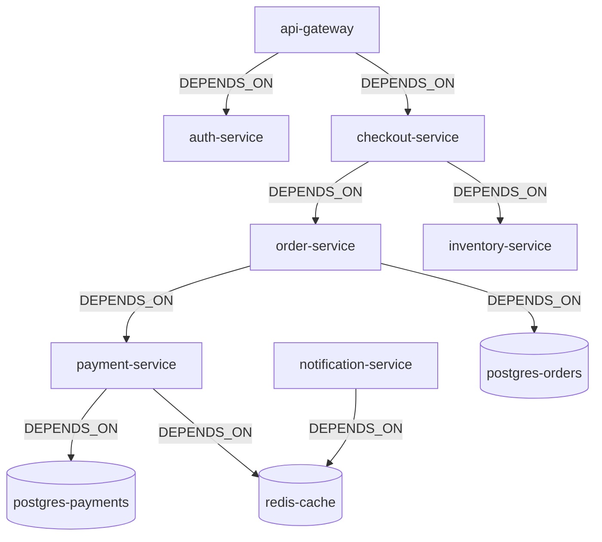

# DevTrace AI — Golden Scenario Specification
> **Disclaimer**: All data, services, deployments, incidents, and resolutions in this document are **100% synthetic**. They represent a reproducible demonstration dataset designed to validate graph traversal algorithms and automated incident investigation.

---

## 1. System Topology & Synthetic Services

The synthetic scenario models a distributed cloud e-commerce platform with 9 interconnected services:



### Depth & Topology Highlights:
- **Longest Dependency Chain (4 Hops)**: `api-gateway` $\rightarrow$ `checkout-service` $\rightarrow$ `order-service` $\rightarrow$ `payment-service` $\rightarrow$ `postgres-payments`.
- **High-Impact Hub**: `payment-service` sits downstream of `order-service`, `checkout-service`, and `api-gateway`.
- **Isolated Branch**: `notification-service` depends only on `redis-cache` and has no dependency relationship with checkout or orders.

---

## 2. Deployments & Timeline (Fixed Epoch Milliseconds)

Assume current incident occurs at $T_0 =$ `1792058400000` (2026-10-15 10:00:00 UTC).

| Deployment ID | Service | Version | Timestamp | Relative to $T_0$ | Role in Scenario |
| :--- | :--- | :--- | :--- | :--- | :--- |
| `dep-checkout-v3.0.0` | `service-checkout` | `v3.0.0` | `1791453600000` | $T - 7\text{ days}$ | **Distractor**: Relevant service, but stale. |
| `dep-order-v2.1.0` | `service-order` | `v2.1.0` | `1791885600000` | $T - 2\text{ days}$ | **Baseline**: Stable previous release. |
| `dep-payment-v2.4.1` | `service-payment` | `v2.4.1` | `1792056600000` | $T - 30\text{ min}$ | **Primary Candidate**: Recent release on downstream dependency, exhibits pool timeout signature. |
| `dep-notification-v1.8.0` | `service-notification` | `v1.8.0` | `1792057500000` | $T - 15\text{ min}$ | **Disconnected Change**: Outside candidate neighborhood; excluded from candidate ranking. |
| `dep-inventory-v1.5.0` | `service-inventory` | `v1.5.0` | `1792057800000` | $T - 10\text{ min}$ | **Connected Distractor**: More recent ($T-10m$) and closer (1 hop), but zero error signature match. |

---

## 3. Historical Incidents & Confirmed Resolutions

### Incident A — Matching Historical Anchor (`inc-2026-08-12-pay`)
- **Service Affected**: `service-payment` (`payment-service`)
- **Reported At**: `1786521600000` (2026-08-12 08:00:00 UTC)
- **Error Signature**: `err-sig-payment-pool-timeout` (`JedisConnectionException / PoolTimeoutException: Could not get a resource from the pool`)
- **Status**: `RESOLVED`
- **Linked Resolution**: `res-pay-timeout-fix`
  - *Title*: "Increase Jedis pool timeout and rollback connection limit"
  - *Confirmed At**: `1786525200000` (2026-08-12 09:00:00 UTC; $+1\text{ hour}$ after reported)
  - *Action Taken*: "Increased Redis connection pool timeout from 2000ms to 10000ms and rolled back connection pool cap."
  - *Remediation Type*: `CONFIG_CHANGE`

### Incident B — Semantic Distractor (`inc-2026-09-01-auth`)
- **Service Affected**: `service-auth` (`auth-service`)
- **Reported At**: `1788253200000` (2026-09-01 09:00:00 UTC)
- **Report Description**: "Timeouts observed during checkout token verification" (contains keywords 'timeout' and 'checkout').
- **Error Signature**: `err-sig-jwt-expired` (`SignatureVerificationException / ClockSkew`)
- **Status**: `RESOLVED`
- **Linked Resolution**: `res-auth-ntp-sync`
  - *Title*: "Resynchronize NTP clock daemon on auth hosts"
  - *Confirmed At**: `1788256800000` (2026-09-01 10:00:00 UTC; $+1\text{ hour}$ after reported)
- **Purpose**: Proves that structured graph matching on `(:Incident)-[:EXHIBITS]->(:ErrorSignature)` correctly rejects auth fixes, despite overlapping free-text keywords.

### Incident C — Unrelated Historical Baseline (`inc-2026-07-20-notif`)
- **Service Affected**: `service-notification` (`notification-service`)
- **Reported At**: `1784541600000` (2026-07-20 10:00:00 UTC)
- **Error Signature**: `err-sig-smtp-disconnect`
- **Status**: `RESOLVED`
- **Linked Resolution**: `res-notif-smtp-failover`
  - *Confirmed At**: `1784545200000` (2026-07-20 11:00:00 UTC; $+1\text{ hour}$ after reported)

---

## 4. Demonstration Acts (Acceptance Test Specification)

### ACT 1 — The Open Incident Investigation
- **Input Submission**:
  ```json
  {
    "description": "Checkout requests are failing after the latest deployment and payment timeouts have increased.",
    "serviceHint": "service-checkout",
    "errorHint": "err-sig-payment-pool-timeout"
  }
  ```
- **Graph Retrieval Operations**:
  1. Entry node resolved: `(:Service {id: 'service-checkout'})`.
  2. Error signature matched: `(:ErrorSignature {id: 'err-sig-payment-pool-timeout'})`.
  3. Downstream dependency traversal: `(checkout-service)-[:DEPENDS_ON*1..3]->(downstream:Service)`.
     - Direct downstream (1 hop): `service-inventory`, `service-order`.
     - Indirect downstream (2+ hops): `service-payment`, `service-postgres-orders`, `service-postgres-payments`, `service-redis-cache`.
  4. Change correlation: Queries deployments on traversed services within 24 hours of $T_0$.
     - Discovers `dep-inventory-v1.5.0` on `service-inventory` ($T - 10\text{ min}$).
     - Discovers `dep-payment-v2.4.1` on `service-payment` ($T - 30\text{ min}$).
     - Rejects `dep-notification-v1.8.0` on `service-notification`: Outside candidate dependency neighborhood; listed as *"recent changes outside the dependency neighborhood, not considered"*.
  5. Shortest path computation:
     ```cypher
     MATCH (src:Service {id: 'service-checkout'}), (tgt:Service {id: 'service-payment'})
     WITH shortestPath((src)-[:DEPENDS_ON*]->(tgt)) AS p
     RETURN [n in nodes(p) | n.name] AS path
     ```
     - Returns: `["checkout-service", "order-service", "payment-service"]`.
  6. Historical resolution lookup: Finds `inc-2026-08-12-pay` exhibiting `err-sig-payment-pool-timeout` on `service-payment`.

- **Rule-Based Candidate Cause Ranking (Verified in Checkpoint 7)**:
  - **Rank 1 (`STRONG` Tier)**: `service-payment` (`payment-service`, 2 hops).
    - *Evidence*: Recent deployment `dep-payment-v2.4.1` (30m prior to $T_0$) AND historical incident `inc-2026-08-12-pay` matching error signature `err-sig-payment-pool-timeout`.
    - *Confirmed Resolution*: `res-pay-timeout-fix` ("Increase Jedis pool timeout and rollback connection limit").
  - **Rank 2 (`MODERATE` Tier)**: `service-inventory` (`inventory-service`, 1 hop).
    - *Evidence*: Recent deployment `dep-inventory-v1.5.0` (10m prior to $T_0$), but zero error signature affinity and no past incidents.
    - *Comparison*: Although topologically closer (1 hop vs 2 hops) and deployed more recently (10m vs 30m), `inventory-service` ranks below `payment-service` because proximity and recency are tie-breakers within tiers, never overriding multi-factor evidence.
  - **Ranks 3–7 (`WEAK` Tier)**: `service-checkout` (0 hops), `service-order` (1 hop), `service-postgres-orders` (2 hops), `service-postgres-payments` (3 hops), `service-redis-cache` (3 hops).
    - *Evidence*: Reachable in downstream dependency chain, but zero deployments in window and no historical signature matches.
  - **Excluded Changes (`ignoredChanges`)**: `dep-notification-v1.8.0` on `service-notification`. Outside the candidate neighborhood; recorded as *"recent changes outside the dependency neighborhood, not considered"*.

---

### ACT 2 — Blast Radius Verification (Verified Ground Truth from `devtrace_test`)
- **Suspected Failing Service**: `service-payment`.
- **Cypher Traversal**:
  ```cypher
  MATCH path = (d:Service)-[:DEPENDS_ON*1..4]->(t:Service {id: 'service-payment'})
  RETURN d.id AS id, d.name AS name, d.serviceType AS serviceType, length(path) AS hops
  ORDER BY hops ASC, d.id ASC
  ```
- **Ground Truth Query Results**:
  | Dependent Service ID | Display Name | Service Type | Hops | Impact Category |
  | :--- | :--- | :--- | :--- | :--- |
  | `service-order` | `order-service` | `MICROSERVICE` | 1 | Direct Caller |
  | `service-checkout` | `checkout-service` | `MICROSERVICE` | 2 | Indirect Caller |
  | `service-gateway` | `api-gateway` | `MICROSERVICE` | 3 | Indirect Caller |

- **Nodes Excluded from Service Blast Radius (Verified by FalkorDB)**:
  - `service-postgres-payments` (`DATABASE`): Callee of payment-service, not caller. Outgoing link `(payment)->(postgres-payments)`.
  - `service-redis-cache` (`CACHE`): Callee of payment-service, not caller. Outgoing link `(payment)->(redis-cache)`.
  - `service-auth`, `service-inventory`, `service-notification`: Completely disjoint branches in the incoming traversal tree.

- **Callee Dependency Traversal of `service-checkout` (Act 1 Traverse)**:
  ```cypher
  MATCH path = (s:Service {id: 'service-checkout'})-[:DEPENDS_ON*1..4]->(d:Service)
  RETURN d.id AS id, d.name AS name, d.serviceType AS serviceType, length(path) AS hops
  ORDER BY hops ASC, d.id ASC
  ```
  - Direct microservices (1 hop): `service-inventory`, `service-order`
  - Indirect microservices (2 hops): `service-payment`
  - Non-microservices / infrastructure callees:
    - `service-postgres-orders` (`DATABASE`, 2 hops)
    - `service-postgres-payments` (`DATABASE`, 3 hops)
    - `service-redis-cache` (`CACHE`, 3 hops)

---

### ACT 3 — Insufficient Evidence Handling
- **Input Submission**:
  ```json
  {
    "description": "Inventory service latency is slightly elevated.",
    "serviceHint": "inventory-service"
  }
  ```
- **Graph Inspection**:
  - `inventory-service` has no recent deployments in the last 48 hours.
  - No matching error signatures are found in the text or hinted.
  - No past incidents with resolutions exist for `inventory-service`.
- **Expected System Output**:
  - Status: `"INSUFFICIENT_EVIDENCE"`
  - Missing Evidence Explicitly Declared:
    - `"No deployment events recorded for inventory-service within the last 48 hours."`
    - `"No known error signatures matched in incident description."`
    - `"No matching historical resolutions available."`
  - The system refuses to fabricate confidence percentages or speculate without graph data.

---

### ACT 4 — Resolution Write-Back & Knowledge Evolution
1. **User Action**: The on-call engineer mitigates ACT 1 and calls `POST /api/resolutions/confirm`:
   ```json
   {
     "incidentId": "inc-2026-10-15-checkout",
     "serviceId": "service-payment",
     "title": "Roll back Jedis connection pool cap to 50",
     "remediationType": "CONFIG_CHANGE",
     "actionTaken": "Reverted connection pool limit constraint in Helm values and restarted payment-service pods.",
     "confirmedBy": "oncall-dev"
   }
   ```
2. **Graph Persistence**:
   - Creates `(:Resolution {id: 'res-2026-10-15-pool-fix'})`.
   - Links `(res)-[:RESOLVES]->(inc-2026-10-15-checkout)`.
   - Links `(res)-[:APPLIES_TO]->(service-payment)`.
3. **Subsequent Investigation**:
   A new incident is submitted: *"Orders timing out during payment gateway handoff"*.
   - **System Behavior**: The investigation retrieves BOTH the historical `res-pay-timeout-fix` AND the newly written `res-2026-10-15-pool-fix`, demonstrating that DevTrace AI gets smarter with each confirmed resolution.

---

### ACT 5 — The Graph-Removal Test
- **Experiment**: Run the identical ACT 1 investigation against an empty graph or a graph where `DEPENDS_ON` relationships have been deleted.
- **Expected Outcome**:
  - The system can observe that `checkout-service` was mentioned.
  - The system CANNOT trace `checkout-service` to `payment-service`.
  - The system FAILS to identify `dep-payment-v2.4.1` as a candidate cause because there is no graph path connecting them.
- **Significance**: Proves to judges that FalkorDB graph connectivity is indispensable to the product.

---

## 5. Standard Structured Investigation Report Format

Every investigation produces a response following this strict schema:

```json
{
  "incidentId": "inv-2026-10-15-001",
  "investigationStatus": "COMPLETED",
  "observedFacts": [
    {
      "source": "GRAPH_QUERY",
      "statement": "Symptom service identified: CheckoutService (service-checkout)",
      "evidence": "MATCH (s:Service {id: 'service-checkout'}) RETURN s"
    },
    {
      "source": "GRAPH_QUERY",
      "statement": "Error signature identified: HTTP 504 Gateway Timeout (err-sig-gateway-timeout)",
      "evidence": "Matched keywords: ['timeout', '504']"
    }
  ],
  "graphDerivedRelationships": [
    {
      "type": "DOWNSTREAM_DEPENDENCY_CHAIN",
      "path": ["CheckoutService", "OrderService", "PaymentService"],
      "cypherQuery": "MATCH (src:Service {id: 'service-checkout'}), (tgt:Service {id: 'service-payment'}) WITH shortestPath((src)-[:DEPENDS_ON*]->(tgt)) AS p RETURN [n in nodes(p) | n.name]"
    },
    {
      "type": "POTENTIAL_BLAST_RADIUS",
      "failingService": "PaymentService",
      "directDependents": ["OrderService"],
      "indirectDependents": ["CheckoutService", "api-gateway"],
      "cypherQuery": "MATCH (d:Service)-[:DEPENDS_ON*1..4]->(t:Service {id: 'service-payment'}) RETURN d.name"
    }
  ],
  "inferredHypotheses": [
    {
      "rank": 1,
      "candidateCause": "Deployment dep-payment-v2.4.1 on PaymentService",
      "deployedAt": 1760520600000,
      "relativeTime": "30 minutes prior to incident",
      "reasoning": "PaymentService is 2 hops downstream of CheckoutService. A deployment occurred 30 minutes prior to failure, and identical error signature HTTP 504 was resolved on PaymentService in past incident inc-2026-08-12-pay."
    }
  ],
  "suggestedNextDiagnosticSteps": [
    {
      "step": 1,
      "action": "Inspect PaymentService Redis connection pool metrics and logs.",
      "evidenceRationale": "Historical resolution res-pay-timeout-fix resolved this exact signature by increasing connection pool timeout."
    },
    {
      "step": 2,
      "action": "Consider rollback of deployment dep-payment-v2.4.1 if connection pool saturation is observed.",
      "evidenceRationale": "Deployment occurred 30 minutes before symptom onset."
    }
  ],
  "relatedHistoricalIncidents": [
    {
      "incidentId": "inc-2026-08-12-pay",
      "title": "Payment timeout surge during peak checkout",
      "confirmedResolution": {
        "resolutionId": "res-pay-timeout-fix",
        "actionTaken": "Increased Redis connection pool timeout from 2000ms to 10000ms and rolled back connection pool cap."
      }
    }
  ]
}
```
