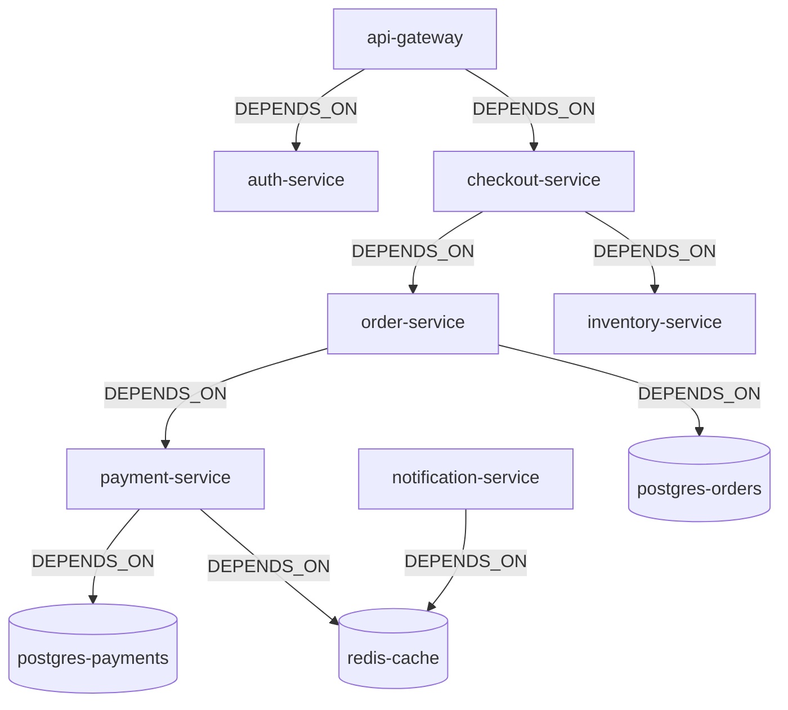

# DevTrace AI — Golden Scenario Specification
> **Disclaimer**: All data, services, deployments, incidents, and resolutions in this document are **100% synthetic**. They represent a reproducible demonstration dataset designed to validate graph traversal algorithms and automated incident investigation.

---

## 1. System Topology & Synthetic Services

The synthetic scenario models a distributed cloud e-commerce platform with 9 interconnected services:



### Depth & Topology Highlights:
- **Longest Dependency Chain (4 Hops)**: `api-gateway` $\rightarrow$ `checkout-service` $\rightarrow$ `order-service` $\rightarrow$ `payment-service` $\rightarrow$ `postgres-payments`.
- **High-Impact Hub**: `payment-service` sits downstream of `order-service`, `checkout-service`, and `api-gateway`.
- **Isolated Branch**: `notification-service` depends only on `redis-cache` and has no dependency relationship with checkout or orders.

---

## 2. Deployments & Timeline (Fixed Epoch Milliseconds)

Assume current incident occurs at $T_0 =$ `1760522400000` (2026-10-15 10:00:00 UTC).

| Deployment ID | Service | Version | Timestamp | Relative to $T_0$ | Role in Scenario |
| :--- | :--- | :--- | :--- | :--- | :--- |
| `dep-checkout-v3.0.0` | `checkout-service` | `v3.0.0` | `1759917600000` | $T - 7\text{ days}$ | **Distractor**: Relevant service, but stale. |
| `dep-notification-v1.8.0` | `notification-service` | `v1.8.0` | `1760521500000` | $T - 15\text{ min}$ | **Distractor**: Recent deployment, but topologically disconnected. |
| `dep-payment-v2.4.1` | `payment-service` | `v2.4.1` | `1760520600000` | $T - 30\text{ min}$ | **Candidate Cause**: Recent deployment on downstream dependency. |
| `dep-order-v2.1.0` | `order-service` | `v2.1.0` | `1760349600000` | $T - 2\text{ days}$ | **Baseline**: Stable previous release. |

---

## 3. Historical Incidents & Confirmed Resolutions

### Incident A — Matching Historical Anchor (`inc-2026-08-12-pay`)
- **Service Affected**: `payment-service`
- **Error Signature**: `err-sig-gateway-timeout` (`HTTP 504 / GatewayTimeoutException`)
- **Status**: `RESOLVED`
- **Linked Resolution**: `res-pay-timeout-fix`
  - *Title*: "Increase Jedis pool timeout and rollback connection limit"
  - *Action Taken*: "Increased Redis connection pool timeout from 2000ms to 10000ms and rolled back connection pool cap."
  - *Remediation Type*: `CONFIG_CHANGE`

### Incident B — Semantic Distractor (`inc-2026-09-01-auth`)
- **Service Affected**: `auth-service`
- **Report Description**: "Timeouts observed during checkout token verification" (contains keywords 'timeout' and 'checkout').
- **Error Signature**: `err-sig-jwt-expired` (`SignatureVerificationException / ClockSkew`)
- **Status**: `RESOLVED`
- **Linked Resolution**: `res-auth-ntp-sync`
  - *Title*: "Resynchronize NTP clock daemon on auth hosts"
- **Purpose**: Proves that structured graph matching on `(:Incident)-[:EXHIBITS]->(:ErrorSignature)` correctly rejects auth fixes, despite overlapping free-text keywords.

### Incident C — Unrelated Historical Baseline (`inc-2026-07-20-notif`)
- **Service Affected**: `notification-service`
- **Error Signature**: `err-sig-smtp-disconnect`
- **Status**: `RESOLVED`
- **Linked Resolution**: `res-notif-smtp-failover`

---

## 4. Demonstration Acts (Acceptance Test Specification)

### ACT 1 — The Open Incident Investigation
- **Input Submission**:
  ```json
  {
    "description": "Checkout requests are failing after the latest deployment and payment timeouts have increased.",
    "serviceHint": "checkout-service",
    "errorHint": "err-sig-gateway-timeout"
  }
  ```
- **Graph Retrieval Operations**:
  1. Entry node resolved: `(:Service {id: 'service-checkout'})`.
  2. Error signature matched: `(:ErrorSignature {id: 'err-sig-gateway-timeout'})`.
  3. Downstream dependency traversal: `(checkout-service)-[:DEPENDS_ON*1..3]->(downstream:Service)`.
     - Discovers `order-service` (1 hop) and `payment-service` (2 hops).
  4. Change correlation: Queries deployments on traversed services within 24 hours of $T_0$.
     - Discovers `dep-payment-v2.4.1` on `payment-service` ($T - 30\text{ min}$).
  5. Shortest path computation:
     ```cypher
     MATCH (src:Service {id: 'service-checkout'}), (tgt:Service {id: 'service-payment'})
     WITH shortestPath((src)-[:DEPENDS_ON*]->(tgt)) AS p
     RETURN [n in nodes(p) | n.name] AS path
     ```
     - Returns: `["CheckoutService", "OrderService", "PaymentService"]`.
  6. Historical resolution lookup: Finds `inc-2026-08-12-pay` exhibiting `err-sig-gateway-timeout` on `payment-service`.
- **Expected Ranked Candidate Causes (Order)**:
  1. **Rank 1**: `dep-payment-v2.4.1` on `payment-service` (Recent change on direct dependency path + matches historical resolved incident `inc-2026-08-12-pay`).
  2. **Rank 2**: `dep-notification-v1.8.0` on `notification-service` (Recent change, but penalised due to zero topological dependency path).
  3. **Rank 3**: `dep-checkout-v3.0.0` on `checkout-service` (On affected service, but penalised due to 7-day age).

---

### ACT 2 — Blast Radius Verification
- **Suspected Failing Service**: `service-payment`.
- **Cypher Traversal**:
  ```cypher
  MATCH (dependents:Service)-[:DEPENDS_ON*1..4]->(target:Service {id: 'service-payment'})
  RETURN dependents.id AS dependentId, dependents.name AS dependentName
  ```
- **Expected Direct Dependents (1 hop)**:
  - `order-service`
- **Expected Indirect Dependents (2+ hops)**:
  - `checkout-service` (2 hops)
  - `api-gateway` (3 hops)
- **Services That MUST NOT Appear in Blast Radius**:
  - `postgres-payments`, `redis-cache` (Callees of payment-service, not callers).
  - `auth-service`, `inventory-service`, `notification-service` (Independent branches with no dependency on payment-service).

---

### ACT 3 — Insufficient Evidence Handling
- **Input Submission**:
  ```json
  {
    "description": "Inventory service latency is slightly elevated.",
    "serviceHint": "inventory-service"
  }
  ```
- **Graph Inspection**:
  - `inventory-service` has no recent deployments in the last 48 hours.
  - No matching error signatures are found in the text or hinted.
  - No past incidents with resolutions exist for `inventory-service`.
- **Expected System Output**:
  - Status: `"INSUFFICIENT_EVIDENCE"`
  - Missing Evidence Explicitly Declared:
    - `"No deployment events recorded for inventory-service within the last 48 hours."`
    - `"No known error signatures matched in incident description."`
    - `"No matching historical resolutions available."`
  - The system refuses to fabricate confidence percentages or speculate without graph data.

---

### ACT 4 — Resolution Write-Back & Knowledge Evolution
1. **User Action**: The on-call engineer mitigates ACT 1 and calls `POST /api/resolutions/confirm`:
   ```json
   {
     "incidentId": "inc-2026-10-15-checkout",
     "serviceId": "service-payment",
     "title": "Roll back Jedis connection pool cap to 50",
     "remediationType": "CONFIG_CHANGE",
     "actionTaken": "Reverted connection pool limit constraint in Helm values and restarted payment-service pods.",
     "confirmedBy": "oncall-dev"
   }
   ```
2. **Graph Persistence**:
   - Creates `(:Resolution {id: 'res-2026-10-15-pool-fix'})`.
   - Links `(res)-[:RESOLVES]->(inc-2026-10-15-checkout)`.
   - Links `(res)-[:APPLIES_TO]->(service-payment)`.
3. **Subsequent Investigation**:
   A new incident is submitted: *"Orders timing out during payment gateway handoff"*.
   - **System Behavior**: The investigation retrieves BOTH the historical `res-pay-timeout-fix` AND the newly written `res-2026-10-15-pool-fix`, demonstrating that DevTrace AI gets smarter with each confirmed resolution.

---

### ACT 5 — The Graph-Removal Test
- **Experiment**: Run the identical ACT 1 investigation against an empty graph or a graph where `DEPENDS_ON` relationships have been deleted.
- **Expected Outcome**:
  - The system can observe that `checkout-service` was mentioned.
  - The system CANNOT trace `checkout-service` to `payment-service`.
  - The system FAILS to identify `dep-payment-v2.4.1` as a candidate cause because there is no graph path connecting them.
- **Significance**: Proves to judges that FalkorDB graph connectivity is indispensable to the product.

---

## 5. Standard Structured Investigation Report Format

Every investigation produces a response following this strict schema:

```json
{
  "incidentId": "inv-2026-10-15-001",
  "investigationStatus": "COMPLETED",
  "observedFacts": [
    {
      "source": "GRAPH_QUERY",
      "statement": "Symptom service identified: CheckoutService (service-checkout)",
      "evidence": "MATCH (s:Service {id: 'service-checkout'}) RETURN s"
    },
    {
      "source": "GRAPH_QUERY",
      "statement": "Error signature identified: HTTP 504 Gateway Timeout (err-sig-gateway-timeout)",
      "evidence": "Matched keywords: ['timeout', '504']"
    }
  ],
  "graphDerivedRelationships": [
    {
      "type": "DOWNSTREAM_DEPENDENCY_CHAIN",
      "path": ["CheckoutService", "OrderService", "PaymentService"],
      "cypherQuery": "MATCH (src:Service {id: 'service-checkout'}), (tgt:Service {id: 'service-payment'}) WITH shortestPath((src)-[:DEPENDS_ON*]->(tgt)) AS p RETURN [n in nodes(p) | n.name]"
    },
    {
      "type": "POTENTIAL_BLAST_RADIUS",
      "failingService": "PaymentService",
      "directDependents": ["OrderService"],
      "indirectDependents": ["CheckoutService", "api-gateway"],
      "cypherQuery": "MATCH (d:Service)-[:DEPENDS_ON*1..4]->(t:Service {id: 'service-payment'}) RETURN d.name"
    }
  ],
  "inferredHypotheses": [
    {
      "rank": 1,
      "candidateCause": "Deployment dep-payment-v2.4.1 on PaymentService",
      "deployedAt": 1760520600000,
      "relativeTime": "30 minutes prior to incident",
      "reasoning": "PaymentService is 2 hops downstream of CheckoutService. A deployment occurred 30 minutes prior to failure, and identical error signature HTTP 504 was resolved on PaymentService in past incident inc-2026-08-12-pay."
    }
  ],
  "suggestedNextDiagnosticSteps": [
    {
      "step": 1,
      "action": "Inspect PaymentService Redis connection pool metrics and logs.",
      "evidenceRationale": "Historical resolution res-pay-timeout-fix resolved this exact signature by increasing connection pool timeout."
    },
    {
      "step": 2,
      "action": "Consider rollback of deployment dep-payment-v2.4.1 if connection pool saturation is observed.",
      "evidenceRationale": "Deployment occurred 30 minutes before symptom onset."
    }
  ],
  "relatedHistoricalIncidents": [
    {
      "incidentId": "inc-2026-08-12-pay",
      "title": "Payment timeout surge during peak checkout",
      "confirmedResolution": {
        "resolutionId": "res-pay-timeout-fix",
        "actionTaken": "Increased Redis connection pool timeout from 2000ms to 10000ms and rolled back connection pool cap."
      }
    }
  ]
}
```
