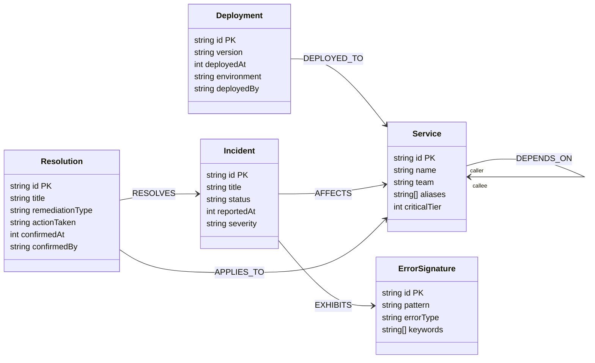

# DevTrace AI — Graph Data Model Specification

## 1. Core Investigation Questions
The DevTrace AI graph schema is designed backwards from the exact operational questions an incident investigation must answer:
1. **Symptom Mapping**: Which services are reporting errors or degraded performance?
2. **Dependency & Topology Traversal**: Which services does the symptom service depend on (upstream/downstream call chain)?
3. **Change Detection**: What deployments or configuration changes occurred on or near the affected service around the incident window?
4. **Failure Path Tracing**: What is the shortest dependency path connecting a recently modified service to the symptom service?
5. **Blast Radius Calculation**: If a specific service is failing or degraded, which services are directly and indirectly impacted?
6. **Historical Experience Retrieval**: Which past incidents exhibited the same error signature or failure path?
7. **Resolution Reuse**: What confirmed resolution fixed those past incidents, and can it remediate the current failure?

---

## 2. Schema Architecture & Mermaid Diagram



---

## 3. Node Label Specifications

### A. `Service`
- **Meaning**: A discrete microservice, backend component, or infrastructure service (e.g. database, cache) within the topology.
- **Required Properties**:
  - `id` (`string`, unique): Unique identifier (e.g. `"service-payment"`).
  - `name` (`string`): Display name (e.g. `"PaymentService"`).
  - `team` (`string`): Engineering team owning the service (e.g. `"Payments Core"`).
  - `aliases` (`string`): Comma-separated alias keywords used for deterministic free-text matching (e.g. `"payment,payments,checkout-payment,gateway"`).
  - `criticalTier` (`int`): Tier level (`1` for mission-critical customer-facing, `2` for internal, `3` for async).
- **Example Record**:
  ```cypher
  (:Service {
    id: "service-payment",
    name: "PaymentService",
    team: "Payments Core",
    aliases: "payment,payments,checkout-payment,payment-gateway",
    criticalTier: 1
  })
  ```
- **Investigation Role**: Serves as the topological anchor for dependency traversal, blast-radius queries, and change detection.

### B. `Deployment`
- **Meaning**: An immutable deployment event where a specific service artifact or configuration was released.
- **Required Properties**:
  - `id` (`string`, unique): Unique deployment ID (e.g. `"dep-payment-v2.4.1"`).
  - `version` (`string`): Semantic version or commit hash (e.g. `"v2.4.1"`).
  - `deployedAt` (`int`): Fixed epoch-millisecond timestamp (e.g. `1760520600000`).
  - `environment` (`string`): Environment (e.g. `"production"`).
  - `deployedBy` (`string`): Engineer or CI/CD pipeline name.
- **Example Record**:
  ```cypher
  (:Deployment {
    id: "dep-payment-v2.4.1",
    version: "v2.4.1",
    deployedAt: 1760520600000,
    environment: "production",
    deployedBy: "github-actions"
  })
  ```
- **Investigation Role**: Correlated against incident reporting time to infer candidate root causes.

### C. `ErrorSignature`
- **Meaning**: A normalized, clustered error fingerprint or classification.
- **Required Properties**:
  - `id` (`string`, unique): Unique error signature ID (e.g. `"err-sig-gateway-timeout"`).
  - `pattern` (`string`): Error message pattern or exception class (e.g. `"HTTP 504 / GatewayTimeoutException"`).
  - `errorType` (`string`): Category (e.g. `"TIMEOUT"`, `"CONNECTION"`, `"AUTHENTICATION"`).
  - `keywords` (`string`): Comma-separated tokens for deterministic text parsing (e.g. `"timeout,timed out,504,gateway timeout,connection timeout"`).
- **Example Record**:
  ```cypher
  (:ErrorSignature {
    id: "err-sig-gateway-timeout",
    pattern: "HTTP 504 Gateway Timeout",
    errorType: "TIMEOUT",
    keywords: "timeout,timed out,504,gateway timeout,read timeout"
  })
  ```
- **Investigation Role**: Connects new incidents to historical incidents with identical failure patterns.

### D. `Incident`
- **Meaning**: An operational incident, failure event, or degradation report.
- **Required Properties**:
  - `id` (`string`, unique): Unique incident identifier (e.g. `"inc-2026-08-12-pay"`).
  - `title` (`string`): Summary description of the incident.
  - `status` (`string`): Incident lifecycle status (`"OPEN"`, `"INVESTIGATING"`, `"RESOLVED"`).
  - `reportedAt` (`int`): Fixed epoch-millisecond timestamp when the incident began.
  - `severity` (`string`): Impact level (`"P1"`, `"P2"`, `"P3"`).
- **Example Record**:
  ```cypher
  (:Incident {
    id: "inc-2026-08-12-pay",
    title: "Payment timeout surge during peak checkout",
    status: "RESOLVED",
    reportedAt: 1754985600000,
    severity: "P1"
  })
  ```
- **Investigation Role**: Stores symptoms and provides historical benchmark cases for resolution retrieval.

### E. `Resolution`
- **Meaning**: A confirmed, human-verified remediation action that resolved an incident.
- **Required Properties**:
  - `id` (`string`, unique): Unique resolution ID (e.g. `"res-pay-timeout-fix"`).
  - `title` (`string`): Short summary of the resolution.
  - `remediationType` (`string`): Categorization (`"ROLLBACK"`, `"CONFIG_CHANGE"`, `"RESTART"`, `"CAPACITY_INCREASE"`).
  - `actionTaken` (`string`): Detailed description of the verified corrective action.
  - `confirmedAt` (`int`): Fixed epoch-millisecond timestamp when verified.
  - `confirmedBy` (`string`): Authorized engineer who marked the resolution confirmed.
- **Example Record**:
  ```cypher
  (:Resolution {
    id: "res-pay-timeout-fix",
    title: "Increase Jedis pool timeout and rollback connection limit",
    remediationType: "CONFIG_CHANGE",
    actionTaken: "Increased Redis connection pool timeout from 2000ms to 10000ms and rolled back connection pool cap",
    confirmedAt: 1754989200000,
    confirmedBy: "sre-oncall"
  })
  ```
- **Investigation Role**: Surfaces actionable, evidence-backed fixes when a similar failure pattern is detected.

---

## 4. Relationship Specifications

### A. `(:Service)-[:DEPENDS_ON]->(:Service)`
- **Unambiguous Direction**: `(A:Service)-[:DEPENDS_ON]->(B:Service)` means **Service A calls Service B** (Service A depends on Service B).
- **Operational Meaning**: A degradation or outage in Service B propagates upstream to Service A.
- **Blast Radius Direction**: To find the blast radius of a failing service `B`, we traverse **incoming** edges (`(dependents:Service)-[:DEPENDS_ON*1..4]->(B)`).
- **Example**: `(:Service {name: 'CheckoutService'})-[:DEPENDS_ON]->(:Service {name: 'PaymentService'})`.

### B. `(:Deployment)-[:DEPLOYED_TO]->(:Service)`
- **Direction**: `(d:Deployment)-[:DEPLOYED_TO]->(s:Service)`.
- **Operational Meaning**: Deployment event `d` updated the software running on Service `s`.
- **Query Role**: Correlated in candidate cause ranking: `MATCH (d:Deployment)-[:DEPLOYED_TO]->(s:Service) WHERE d.deployedAt <= incidentTime`.

### C. `(:Incident)-[:AFFECTS]->(:Service)`
- **Direction**: `(i:Incident)-[:AFFECTS]->(s:Service)`.
- **Operational Meaning**: The symptom or impact was observed in Service `s`.

### D. `(:Incident)-[:EXHIBITS]->(:ErrorSignature)`
- **Direction**: `(i:Incident)-[:EXHIBITS]->(e:ErrorSignature)`.
- **Operational Meaning**: Incident `i` generated errors matching signature `e`.

### E. `(:Resolution)-[:RESOLVES]->(:Incident)`
- **Direction**: `(r:Resolution)-[:RESOLVES]->(i:Incident)`.
- **Operational Meaning**: Confirmed resolution `r` successfully repaired incident `i`.

### F. `(:Resolution)-[:APPLIES_TO]->(:Service)`
- **Direction**: `(r:Resolution)-[:APPLIES_TO]->(s:Service)`.
- **Operational Meaning**: Fix `r` was executed on service `s`.

---

## 5. Rejected Schema Elements & Justification

1. **Rejected Label: `Team` / `Engineer` as a separate node**:
   - *Justification*: Team ownership is static metadata used for notifications, not topological traversal. Representing team as a property (`s.team`) on `Service` avoids unnecessary graph joins and keeps the schema minimal.
2. **Rejected Label: `ErrorEvent` (individual error instance)**:
   - *Justification*: High-volume log events clutter the graph and destroy traversal performance. Grouping error occurrences into normalized `ErrorSignature` nodes keeps graph queries bounded and explainable.
3. **Rejected Relationship: `RELATED_TO` (undirected/generic link)**:
   - *Justification*: Generic relations obscure causality. Past incident similarity is derived through typed, explainable Cypher paths (`(:Incident)-[:EXHIBITS]->(:ErrorSignature)<-[:EXHIBITS]-(:Incident)`), rather than arbitrary manual links.

---

## 6. Deterministic Free-Text Mapping & Honest Limitations

### How Free-Text Becomes Graph Entry Points
DevTrace AI parses user descriptions deterministically without requiring an LLM:
1. **Service Extraction**: Tokenizes the input text and matches tokens against `Service.aliases` and `Service.name` using case-insensitive substring matching.
2. **Error Signature Extraction**: Matches text tokens against `ErrorSignature.keywords` (e.g. `"timeout"`, `"connection reset"`).
3. **Optional Structured Hints**: The API request accepts optional fields (`serviceHint`, `errorHint`, `incidentTimestamp`) to bypass text ambiguity when automated monitoring alerts submit incidents.

### Honest Limitations
- **Vocabulary Gap**: If a user submits metaphorical text like *"the green submit button is frozen"*, deterministic matching cannot infer that this pertains to `service-checkout` unless `"green submit button"` was pre-configured in aliases.
- **Ambiguity**: If multiple services share a keyword, structured hints or interactive user clarification must disambiguate. The system explicitly reports `"INSUFFICIENT_EVIDENCE"` rather than fabricating an unsubstantiated guess.

---

## 7. Data Integrity, Indexing & Idempotency Rules

FalkorDB capability probe verified the following constraints:
1. **Exact-Match Index Required First**: Unique constraints in FalkorDB require a supporting index:
   ```cypher
   CREATE INDEX FOR (s:Service) ON (s.id);
   CREATE INDEX FOR (d:Deployment) ON (d.id);
   CREATE INDEX FOR (e:ErrorSignature) ON (e.id);
   CREATE INDEX FOR (i:Incident) ON (i.id);
   CREATE INDEX FOR (r:Resolution) ON (r.id);
   ```
2. **Dedicated Constraint Command**:
   ```redis
   GRAPH.CONSTRAINT CREATE devtrace UNIQUE NODE Service PROPERTIES 1 id
   GRAPH.CONSTRAINT CREATE devtrace UNIQUE NODE Deployment PROPERTIES 1 id
   GRAPH.CONSTRAINT CREATE devtrace UNIQUE NODE ErrorSignature PROPERTIES 1 id
   GRAPH.CONSTRAINT CREATE devtrace UNIQUE NODE Incident PROPERTIES 1 id
   GRAPH.CONSTRAINT CREATE devtrace UNIQUE NODE Resolution PROPERTIES 1 id
   ```
3. **Idempotent Seed Writes**: All seed queries use `MERGE` with `ON CREATE SET` and `ON MATCH SET`. Re-running the seed script never duplicates nodes or relationships.
